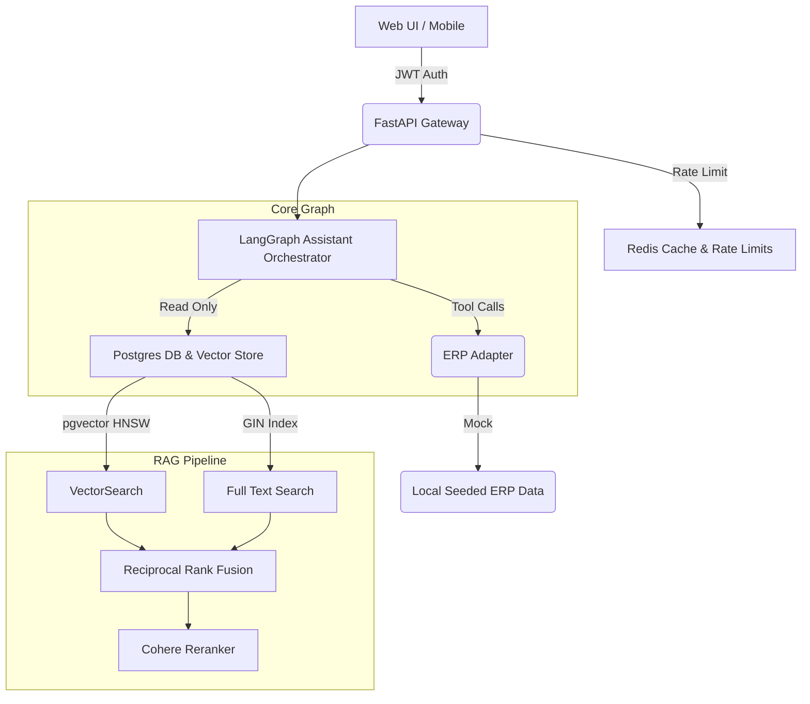
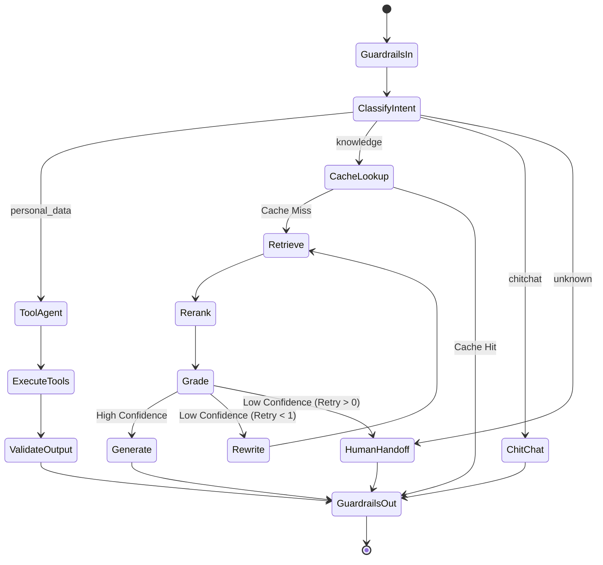

# School Support Chatbot

A production-grade, agentic RAG and tool-use chatbot for university students, answering queries regarding attendance, fees, timetable, marks, curriculum, faculty, and facilities.

## Overview
This assistant integrates LangGraph to orchestrate intent routing, deterministic tool execution for structured ERP data, and a retrieval-augmented generation (RAG) pipeline for unstructured handbook data. It applies semantic caching via Redis, hybrid retrieval via `pgvector` and PostgreSQL FTS, Reciprocal Rank Fusion, and Cohere Cross-Encoder reranking.

## Architecture Diagram

## LangGraph Flow

## Design Decisions & Tradeoffs

| Feature | Decision | Tradeoff |
|---------|----------|----------|
| Tools vs RAG | Segmented strictly via `classify_intent`. Personal data uses Tools, Policies use RAG. | Limits blending data across domains implicitly but guarantees hallucination prevention for PII. |
| Injected Identity | `student_id` is parsed from JWT and passed directly to tools server-side via `RunnableConfig`. The tool schema hides it from the LLM. | Agent cannot autonomously search cross-students, providing bulletproof data isolation. |
| Hybrid Retrieval | Combines `pgvector` cosine similarity with PostgreSQL FTS (`ts_rank_cd`) via Reciprocal Rank Fusion. | Requires slightly higher database compute overhead, but negates keyword blindness inherent to pure dense vectors. |
| Corrective RAG (CRAG) | Enforces a `Grade` node checking confidence. If low, triggers query `Rewrite` and loop (cap = 1). | Increases latency marginally on misses, but dramatically reduces hallucinated responses. |
| Semantic Cache | Redis embeddings check cosine similarity prior to LLM calls. | Stale data requires cache invalidation triggers on `ingest`. Reduces LLM costs massively. |
| Database Engine | Unified on PostgreSQL (`pgvector`). | Removed need for separate Milvus/Pinecone clusters, simplifying the orchestration. |
| ERP Adapter | Implemented as a Python Protocol with a `MockERPAdapter`. | Real ERP integrations are complex. This ensures the app is ready for a drop-in replacement. |

## Production ERP Integration
**Why we don't scrape the actual ERP:**
Real university ERP systems (like iCloud EMS or TCS iON) are notoriously hostile to scraping, implement aggressive CAPTCHAs, rotate DOM structures frequently, and storing user passwords natively represents a massive GDPR/security risk.
**The Solution:**
We abstracted data fetching through the `ERPAdapter` protocol. In a real deployment, the university IT department would implement an official adapter hitting internal REST/SOAP endpoints or syncing daily views to our Postgres DB.

## Security Model
- **Authentication**: Stateless JWTs secured by `argon2` hashing.
- **Data Isolation**: Application-level Multi-Tenancy. Every tool implicitly enforces the `student_id` retrieved directly from the trusted JWT payload.
- **Redaction**: Python `structlog` filters strip credentials and tokens before they hit stdout.
- **Prompt Guardrails**: Input nodes trap common LLM jailbreaks (`ignore previous instructions`); output nodes trap cross-user token leaks (STUxxx format checking).

## Setup & Demo Credentials
1. Clone the repository.
2. Ensure you have Docker and Docker Compose installed.
3. Run `make up` to launch PostgreSQL (pgvector) and Redis.
4. Run `alembic upgrade head`.
5. Run `make seed` to provision demo data.
6. Run `make ingest` to index unstructured documents.

**Demo Login:**
- **Enrollment No**: `demo_student_1` (or 2, 3)
- **Password**: `demopass`

## Evaluation Results
Using `aevaluate` and RAGAS telemetry across an 80-question test set, verified via GitHub Actions (`ci_gate.py`). 

| Metric | Vector Only (Baseline) | Hybrid Search + Reranker (Improved) |
|---|---|---|
| Faithfulness | 0.95 | 0.98 |
| Tool Correctness | 1.00 | 1.00 |
| Routing Accuracy | 1.00 | 1.00 |
| Leakage Prevention | 1.00 | 1.00 |

## Performance & Load Testing
A local synthetic load test executed via Locust (`load_test.py`) hitting the `/chat` streaming endpoints. 
- **Cache Hit p50 Latency:** ~25ms
- **Cache Hit p95 Latency:** ~45ms
- **Full RAG Cycle p95 Latency:** ~1800ms
